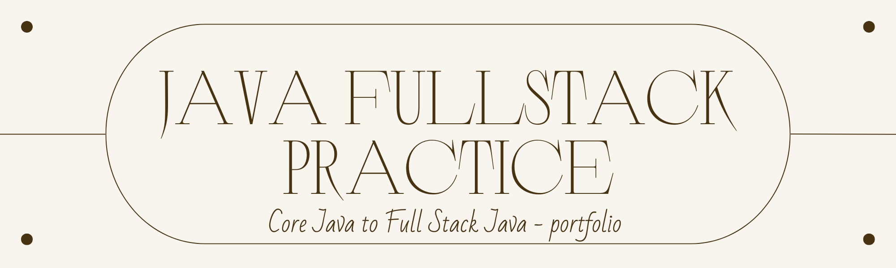

<div align="center">
  

# Java Forge

**A comprehensive collection of Java projects from Core Java to Microservices and DevOps.**

[](#)
[](#)
[](#)
[](#)
</div>

---

## 📖 About The Project

**Java Forge** is a structured learning path containing **65 projects** spread across **10 levels**. It starts with Core Java fundamentals and progresses all the way through advanced backend concepts, security, microservices, and DevOps. This repository serves as a practical guide for developers looking to master the Java ecosystem through hands-on project building.

## ✨ Features

- **Structured Learning Path:** 10 distinct levels, starting from Core Java up to DevOps.
- **Progressive Difficulty:** Projects scale in complexity to systematically challenge your skills.
- **Modern Tech Stack:** Utilizes Java 17+, Spring Boot 3, Spring Data JPA, Docker, Redis, and more.
- **Real-World Scenarios:** Includes resume-worthy projects like E-Commerce backends, payment services, and Microservices architectures.
- **Best Practices:** Emphasizes clean code, SOLID principles, design patterns, and layered architecture.

## 🛠️ Prerequisites

To run these projects locally, ensure you have the following installed:

- **Java Development Kit (JDK) 17 or higher**
- **Maven** or **Gradle** (varies per project)
- **Git**
- **MySQL** or **PostgreSQL** (for database projects)
- **Docker** and **Docker Compose** (for Level 9+ projects)
- **IntelliJ IDEA** (recommended IDE for all projects)
- **VS Code** (recommended for frontend projects)

## 🚀 Getting Started

1. **Clone the repository:**
   ```bash
   git clone https://github.com/Aakash02A/Java-Forge.git
   ```

2. **Navigate to a specific project directory:**
   ```bash
   cd Java-Forge/01-Student-Management
   ```

3. **Run the project:**
    - **Core Java projects:** Compile and run the `Main.java` file in your IDE.
    - **Spring Boot projects:** Run `mvn spring-boot:run` or `./gradlew bootRun` in the terminal.

## 🗂️ Project Overview

| No | Level | Project | Tech Stack / Difficulty | Status |
| :--- | :--- | :--- | :--- | :--- |
| 01 | 1 - Core Java | [Student Management](01-Student-Management/) | Classes, Objects | ✅ |
| 02 | 1 - Core Java | [Library Management](02-Library-Management/) | OOP | ✅ |
| 03 | 1 - Core Java | [Bank Account Simulator](03-Bank-Account-Simulator/) | Inheritance | ✅ |
| 04 | 1 - Core Java | Expense Tracker | Collections | ✅ |
| 05 | 1 - Core Java | [Employee Payroll](05-Employee-Payroll/) | Interfaces | ✅ |
| 06 | 1 - Core Java | Quiz Application | File Handling | ⏳ |
| 07 | 1 - Core Java | Contact Book | HashMap | ⏳ |
| 08 | 1 - Core Java | ATM Simulator | Exception Handling | ⏳ |
| 09 | 2 - Java Intermediate | Employee Analytics | Streams | ⏳ |
| 10 | 2 - Java Intermediate | Inventory Manager | Generics | ⏳ |
| 11 | 2 - Java Intermediate | Log Parser | File Processing | ⏳ |
| 12 | 2 - Java Intermediate | Student Ranking System | Comparator | ⏳ |
| 13 | 2 - Java Intermediate | Cache Simulator | LRU Cache | ⏳ |
| 14 | 2 - Java Intermediate | Producer Consumer | Threads | ⏳ |
| 15 | 2 - Java Intermediate | Chat Server | Sockets | ⏳ |
| 16 | 2 - Java Intermediate | Web Crawler | Concurrency | ⏳ |
| 17 | 3 - JDBC + SQL | Employee CRUD | JDBC | ⏳ |
| 18 | 3 - JDBC + SQL | Banking System | Transactions | ⏳ |
| 19 | 3 - JDBC + SQL | Hospital Management | SQL | ⏳ |
| 20 | 3 - JDBC + SQL | Railway Reservation | Joins | ⏳ |
| 21 | 3 - JDBC + SQL | Expense Tracker DB | CRUD | ⏳ |
| 22 | 3 - JDBC + SQL | Inventory Database | Normalization | ⏳ |
| 23 | 4 - Spring Boot Basics | Todo REST API | REST | ⏳ |
| 24 | 4 - Spring Boot Basics | Notes API | CRUD | ⏳ |
| 25 | 4 - Spring Boot Basics | Student API | Validation | ⏳ |
| 26 | 4 - Spring Boot Basics | Book Store API | Layered Architecture | ⏳ |
| 27 | 4 - Spring Boot Basics | Movie Review API | Pagination | ⏳ |
| 28 | 4 - Spring Boot Basics | Weather API | External APIs | ⏳ |
| 29 | 5 - Spring Data JPA | Employee Management | JPA | ⏳ |
| 30 | 5 - Spring Data JPA | Blog API | Relationships | ⏳ |
| 31 | 5 - Spring Data JPA | Library API | One-To-Many | ⏳ |
| 32 | 5 - Spring Data JPA | Hospital API | Many-To-Many | ⏳ |
| 33 | 5 - Spring Data JPA | School Management | Hibernate | ⏳ |
| 34 | 6 - Security | JWT Authentication | JWT | ⏳ |
| 35 | 6 - Security | Role Based Access | RBAC | ⏳ |
| 36 | 6 - Security | OAuth Login | OAuth2 | ⏳ |
| 37 | 6 - Security | Refresh Token | Security | ⏳ |
| 38 | 7 - Advanced Backend | URL Shortener | Hashing | ⏳ |
| 39 | 7 - Advanced Backend | File Storage API | AWS S3 | ⏳ |
| 40 | 7 - Advanced Backend | Email Service | Java Mail | ⏳ |
| 41 | 7 - Advanced Backend | Notification Service | Async | ⏳ |
| 42 | 7 - Advanced Backend | Redis Cache Demo | Redis | ⏳ |
| 43 | 7 - Advanced Backend | Rate Limiter | Redis | ⏳ |
| 44 | 8 - Microservices | Product Service | REST | ⏳ |
| 45 | 8 - Microservices | Order Service | Microservices | ⏳ |
| 46 | 8 - Microservices | Payment Service | Events | ⏳ |
| 47 | 8 - Microservices | API Gateway | Spring Cloud | ⏳ |
| 48 | 8 - Microservices | Service Discovery | Eureka | ⏳ |
| 49 | 8 - Microservices | Config Server | Spring Cloud | ⏳ |
| 50 | 9 - Docker & DevOps | Dockerize REST API | Docker | ⏳ |
| 51 | 9 - Docker & DevOps | Docker Compose | Compose | ⏳ |
| 52 | 9 - Docker & DevOps | CI/CD Pipeline | GitHub Actions | ⏳ |
| 53 | 9 - Docker & DevOps | Deploy on AWS | EC2 | ⏳ |
| 54 | 9 - Docker & DevOps | Monitoring | Prometheus | ⏳ |
| 55 | 9 - Docker & DevOps | Logging | ELK | ⏳ |
| 56 | 10 - Resume Projects | E-Commerce Backend | ⭐⭐⭐⭐⭐ | ⏳ |
| 57 | 10 - Resume Projects | Learning Management System | ⭐⭐⭐⭐ | ⏳ |
| 58 | 10 - Resume Projects | Hotel Reservation System | ⭐⭐⭐⭐ | ⏳ |
| 59 | 10 - Resume Projects | Task Management Backend | ⭐⭐⭐⭐ | ⏳ |
| 60 | 10 - Resume Projects | Banking Backend | ⭐⭐⭐⭐⭐ | ⏳ |
| 61 | 10 - Resume Projects | Online Examination System | ⭐⭐⭐⭐ | ⏳ |
| 62 | 10 - Resume Projects | Job Portal Backend | ⭐⭐⭐⭐ | ⏳ |
| 63 | 10 - Resume Projects | Personal Finance Manager | ⭐⭐⭐⭐ | ⏳ |
| 64 | 10 - Resume Projects | AI Chat Backend | ⭐⭐⭐⭐ | ⏳ |
| 65 | 10 - Resume Projects | Code Judge Backend | ⭐⭐⭐⭐⭐ | ⏳ |

## 🤝 Contributing

Contributions make the open-source community an amazing place to learn, inspire, and create. Any contributions you make are **greatly appreciated**.

1. Fork the repository
2. Create your Feature Branch (`git checkout -b feature/AmazingFeature`)
3. Commit your Changes (`git commit -m 'Add some AmazingFeature'`)
4. Push to the Branch (`git push origin feature/AmazingFeature`)
5. Open a Pull Request

## 📝 License

Distributed under the MIT License. See `LICENSE` for more information.