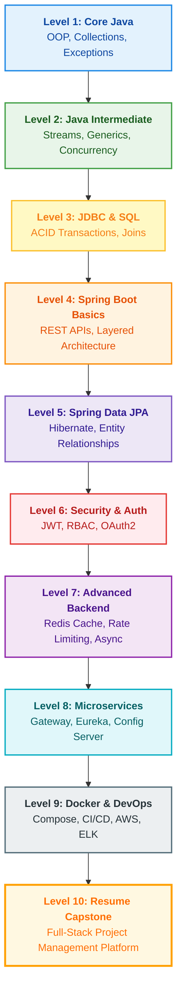

<div align="center">
  

# Java Forge 🛠️

**The Complete Hands-On Java Roadmap — 55 Production-Ready Projects from Core Java to Microservices & DevOps.**

[](CONTRIBUTING.md)
[](LICENSE)
[](#)
[](#)
[](#-project-overview)

<br/>

[](#)
[](#)
[](#)
[](#)
[](#)
[](#)
</div>

---

## 🗺️ Interactive Roadmap



---

## 📖 About The Project

**Java Forge** is an industry-aligned learning path containing **55 projects organized into 10 progressive levels**. It bridges the gap between basic syntax and enterprise software engineering, guiding you step-by-step from Core Java to Spring Boot 3, Distributed Microservices, and Cloud DevOps.

- 🧭 **Curated Learning Tracks:** Choose between a fast-track interview sprint or full mastery. See [TRACKS.md](TRACKS.md).
- 📋 **Personal Progress Checklist:** Track your daily/weekly journey with [PROGRESS.md](PROGRESS.md).
- 🤝 **Open for Contributions:** Beginner-friendly issues, unit test tasks, and challenges. See [CONTRIBUTING.md](CONTRIBUTING.md).

## ✨ Features

- **Structured Learning Path:** 10 levels systematically challenging your skills from console apps to cloud microservices.
- **Enterprise-Grade Stack:** Built with Java 21, Spring Boot 3, Spring Data JPA, Spring Security 6, Redis, Docker, and AWS.
- **Production Patterns:** Layered architecture, DTO pattern, JWT stateless authentication, token bucket rate limiting, and ELK logging.
- **Career & Interview Ready:** Directly prepares you for Java Backend and Full-Stack Engineering technical interviews.

## 🧭 Curated Learning Tracks

Choose the track that fits your schedule:

| Track | Target Audience | Duration | Key Levels |
| :--- | :--- | :--- | :--- |
| **🚀 Fast-Track Interview Sprint** | Java Backend Job Interview Prep | 2–3 Weeks | Core OOP, Streams, Concurrency, SQL, Spring Boot, JWT, Redis |
| **🍃 Spring Boot & Cloud Specialist** | Modern Backend & Microservices | 4–6 Weeks | Levels 4 through 8 (REST, JPA, Security, Microservices) |
| **⚙️ Core Concurrency & Internals** | Deep Language Mechanics & Performance | 3–4 Weeks | Levels 1 & 2 (Generics, LRU Cache, Producer-Consumer, Sockets) |
| **🐳 DevOps & Observability** | Cloud Deployment & Infrastructure | 2–3 Weeks | Level 9 (Docker, CI/CD, AWS EC2, Prometheus, ELK) |
| **👑 Full 55-Project Masterclass** | Zero to Senior Engineer Journey | 12 Weeks | Complete Level 1 to 10 linear progression |

👉 **Explore full project breakdowns for each track in [TRACKS.md](TRACKS.md).**

## 🛠️ Prerequisites

To run these projects locally, ensure you have the following installed:

- **Java Development Kit (JDK) 17 or higher**
- **Maven** or **Gradle** (varies per project)
- **Git**
- **MySQL** or **PostgreSQL** (for database projects)
- **Docker** and **Docker Compose** (for Level 9+ projects)
- **IntelliJ IDEA** (recommended IDE for all projects)
- **VS Code** (recommended for frontend projects)

### Local database credentials

Never commit passwords, API keys, or personal credentials. Database projects that use MySQL provide a `database/database.properties.example`; copy it to `database/database.properties` and put credentials only in the local copy. Root `.gitignore` excludes local credentials files and `.env` files. If a credential was accidentally committed or shared, rotate it; adding it to `.gitignore` does not remove it from Git history.

## 🚀 Getting Started

1. **Clone the repository:**
   ```bash
   git clone https://github.com/Aakash02A/Java-Forge.git
   ```

2. **Navigate to a specific project directory:**
   ```bash
   cd Java-Forge/level-01-core-java/01-Student-Management
   ```

3. **Run the project:**
    - **Core Java projects:** Compile and run the `Main.java` file in your IDE.
    - **Spring Boot projects:** Run `mvn spring-boot:run` or `./gradlew bootRun` in the terminal.

## 🗂️ Project Overview

| No | Level | Project | Tech Stack / Difficulty |
| :--- | :--- | :--- | :--- |
| 01 | 1 - Core Java | [Student Management](level-01-core-java/01-Student-Management/) | Classes, Objects |
| 02 | 1 - Core Java | [Library Management](level-01-core-java/02-Library-Management/) | OOP |
| 03 | 1 - Core Java | [Bank Account Simulator](level-01-core-java/03-Bank-Account-Simulator/) | Inheritance |
| 04 | 1 - Core Java | [Expense Tracker](level-01-core-java/04-Expense-Tracker/) | Collections |
| 05 | 1 - Core Java | [Employee Payroll](level-01-core-java/05-Employee-Payroll/) | Interfaces |
| 06 | 1 - Core Java | [Quiz Application](level-01-core-java/06-Quiz-Application/) | File Handling |
| 07 | 1 - Core Java | [Contact Book](level-01-core-java/07-Contact-Book/) | HashMap |
| 08 | 1 - Core Java | [ATM Simulator](level-01-core-java/08-ATM-Simulator/) | Exception Handling |
| 09 | 2 - Java Intermediate | [Employee Analytics](level-02-java-intermediate/09-Employee-Analytics/) | Streams |
| 10 | 2 - Java Intermediate | [Inventory Manager](level-02-java-intermediate/10-Inventory-Manager/) | Generics |
| 11 | 2 - Java Intermediate | [Log Parser](level-02-java-intermediate/11-Log-Parser/) | File Processing |
| 12 | 2 - Java Intermediate | [Student Ranking System](level-02-java-intermediate/12-Student-Ranking-System/) | Comparator |
| 13 | 2 - Java Intermediate | [Cache Simulator](level-02-java-intermediate/13-Cache-Simulator/) | LRU Cache |
| 14 | 2 - Java Intermediate | [Producer Consumer](level-02-java-intermediate/14-Producer-Consumer/) | Threads |
| 15 | 2 - Java Intermediate | [Chat Server](level-02-java-intermediate/15-Chat-Server/) | Sockets |
| 16 | 2 - Java Intermediate | [URL Shortener](level-02-java-intermediate/16-URL-Shortener/) | Hashing |
| 17 | 3 - JDBC + SQL | [Employee CRUD](level-03-jdbc-sql/17-Employee-CRUD/) | JDBC |
| 18 | 3 - JDBC + SQL | [Banking System](level-03-jdbc-sql/18-Banking-System/) | Transactions |
| 19 | 3 - JDBC + SQL | [Hospital Management](level-03-jdbc-sql/19-Hospital-Management/) | SQL |
| 20 | 3 - JDBC + SQL | [Railway Reservation](level-03-jdbc-sql/20-Railway-Reservation/) | Joins |
| 21 | 3 - JDBC + SQL | [Expense Tracker DB](level-03-jdbc-sql/21-Expense-Tracker-DB/) | CRUD |
| 22 | 3 - JDBC + SQL | [Inventory Database](level-03-jdbc-sql/22-Inventory-Database/) | Normalization |
| 23 | 4 - Spring Boot Basics | [Todo REST API](level-04-spring-boot-basics/23-Todo-REST-API/) | REST |
| 24 | 4 - Spring Boot Basics | [Notes API](level-04-spring-boot-basics/24-Notes-API/) | CRUD |
| 25 | 4 - Spring Boot Basics | [Student API](level-04-spring-boot-basics/25-Student-API/) | Validation |
| 26 | 4 - Spring Boot Basics | [Book Store API](level-04-spring-boot-basics/26-Book-Store-API/) | Layered Architecture |
| 27 | 4 - Spring Boot Basics | [Movie Review API](level-04-spring-boot-basics/27-Movie-Review-API/) | Pagination |
| 28 | 4 - Spring Boot Basics | [Weather API](level-04-spring-boot-basics/28-Weather-API/) | External APIs |
| 29 | 5 - Spring Data JPA | [Employee Management](level-05-spring-data-jpa/29-Employee-Management/) | JPA |
| 30 | 5 - Spring Data JPA | [Blog API](level-05-spring-data-jpa/30-Blog-API/) | Relationships |
| 31 | 5 - Spring Data JPA | [Library API](level-05-spring-data-jpa/31-Library-API/) | One-To-Many |
| 32 | 5 - Spring Data JPA | [Hospital API](level-05-spring-data-jpa/32-Hospital-API/) | Many-To-Many |
| 33 | 5 - Spring Data JPA | [School Management](level-05-spring-data-jpa/33-School-Management/) | Hibernate |
| 34 | 6 - Security | [JWT Authentication](level-06-security/34-JWT-Authentication/) | JWT |
| 35 | 6 - Security | [Role Based Access](level-06-security/35-Role-Based-Access/) | RBAC |
| 36 | 6 - Security | [OAuth Login](level-06-security/36-OAuth-Login/) | OAuth2 |
| 37 | 6 - Security | [Refresh Token](level-06-security/37-Refresh-Token/) | Token Rotation |
| 38 | 7 - Advanced Backend | [URL Shortener](level-07-advanced-backend/38-URL-Shortener/) | Hashing |
| 39 | 7 - Advanced Backend | [File Storage API](level-07-advanced-backend/39-File-Storage-API/) | Local Storage |
| 40 | 7 - Advanced Backend | [Email Service](level-07-advanced-backend/40-Email-Service/) | Java Mail |
| 41 | 7 - Advanced Backend | [Notification Service](level-07-advanced-backend/41-Notification-Service/) | Async |
| 42 | 7 - Advanced Backend | [Redis Cache Demo](level-07-advanced-backend/42-Redis-Cache-Demo/) | Redis |
| 43 | 7 - Advanced Backend | [Rate Limiter](level-07-advanced-backend/43-Rate-Limiter/) | Redis |
| 44 | 8 - Microservices | [Product Service](level-08-microservices/44-Product-Service/) | REST |
| 45 | 8 - Microservices | [Order Service](level-08-microservices/45-Order-Service/) | Microservices |
| 46 | 8 - Microservices | [Payment Service](level-08-microservices/46-Payment-Service/) | Events |
| 47 | 8 - Microservices | [API Gateway](level-08-microservices/47-API-Gateway/) | Spring Cloud |
| 48 | 8 - Microservices | [Service Discovery](level-08-microservices/48-Service-Discovery/) | Eureka |
| 49 | 8 - Microservices | [Config Server](level-08-microservices/49-Config-Server/) | Spring Cloud |
| 50 | 9 - Docker & DevOps | [Dockerize REST API](level-09-docker-devops/50-Dockerize-REST-API/) | Docker |
| 51 | 9 - Docker & DevOps | [Docker Compose](level-09-docker-devops/51-Docker-Compose/) | Compose |
| 52 | 9 - Docker & DevOps | [CI/CD Pipeline](level-09-docker-devops/52-CI-CD-Pipeline/) | GitHub Actions |
| 53 | 9 - Docker & DevOps | [Deploy on AWS](level-09-docker-devops/53-Deploy-on-AWS-EC2/) | EC2 |
| 54 | 9 - Docker & DevOps | [Monitoring](level-09-docker-devops/54-Monitoring-with-Prometheus/) | Prometheus |
| 55 | 9 - Docker & DevOps | [Logging](level-09-docker-devops/55-Logging-with-ELK/) | ELK |
| 56 | 10 - Resume Capstone | [Build: Team Project Management Platform](level-10-resume-capstone/) | React, Spring Boot, MySQL, JWT/RBAC, Redis, testing, Docker, CI/CD, deployment |

The Level 10 capstone is a project to build after completing the learning path; it is not an implemented project in this repository yet. Start as a modular monolith and bring together the concepts from earlier levels: a full-stack UI, secure REST API, relational data model, role-based team access, task workflows, automated tests, containerization, and deployment.

---

## 📈 Track Your Progress

Take ownership of your learning journey with our interactive checklist. Fork the repo and check off each project as you complete it:

👉 **[Open PROGRESS.md](PROGRESS.md)** to start tracking!

---

## 🤝 Contributing & Good First Issues

Contributions make the open-source community an amazing place to learn, inspire, and create. Any contributions you make are **greatly appreciated**!

We have many beginner-friendly opportunities:
- 🧪 **Writing Unit Tests:** Add JUnit 5 / Mockito tests to early console projects.
- 📖 **API Documentation:** Add Swagger UI / OpenAPI docs to Spring Boot APIs.
- 🚀 **Challenges:** Add new stretch goals and edge-case challenges to project READMEs.

Please check out our **[CONTRIBUTING.md](CONTRIBUTING.md)** for our step-by-step contribution guide, code standards, and PR instructions.

---

## 👥 Contributors

Contributions make this project thrive! Want to see your profile listed here?

1. Pick up any task or challenge from **[CONTRIBUTING.md](CONTRIBUTING.md)**.
2. Submit a pull request!
3. All contributors are credited and celebrated.

<p align="left">
  <a href="https://github.com/Aakash02A/Java-Forge/graphs/contributors">
    
  </a>
</p>

---

## ⭐ Show Your Support

If you find this repository helpful, please consider giving it a ⭐ **star**! It helps other developers discover this learning path and motivates continuous updates and new projects.

<p align="left">
  <a href="https://github.com/Aakash02A/Java-Forge/stargazers">
    
  </a>
</p>

---

## 📝 License

Distributed under the MIT License. See `LICENSE` for more information.